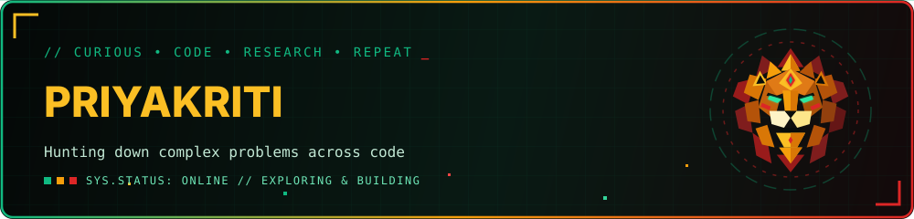

<br/>

> *"Curious little clever fox"*

---

### 🦊 `dossier.yml`
```yaml
identity:
  name: "Priyakriti (also called PJ)"
  approach: "Research-driven & cross-disciplinary"
  mission: "Integrating software skills with unconventional domains to build clever, useful tools."
```

---

### 🔬 Research & Interdisciplinary Matrix

| Domain | Focus & Curiosity | Core Stack |
| :--- | :--- | :--- |
| **Software & Systems** | Clean architectures, automation, & reproducible workflows | `Python` `TypeScript` `Git` `Linux` |
| **Cross-Field Integration** | Blending code **In Cross-domains** | Data modeling, rapid prototyping, & analysis |

---

### 🛠 Toolbox

| Category | Technologies |
| :--- | :--- |
| **Core Languages** | `Python` · `C` · `C++` · `JavaScript (JS)` |
| **Computer Vision & Scientific Computing** | `OpenCV` · `MATLAB` · `GNU Octave` |
| **Web Technologies** | `HTML` · `CSS` |
| **Environment, Workflow & Tooling**| `VS Code` . `GitHub` |

### 🗂 Featured Explorations *(Click to expand)*

<details>
<summary><b>🟢 Engineering Philosophy — How I Work</b></summary>
<br/>
- <b>First Principles:</b> Understand the domain problem deeply before writing a single line of code.<br/>
- <b>Atomic Craft:</b> Build algorithm, Clear documentation, and Maintainable systems.

---

### 📫 Connect
- **LinkedIn:** https://www.linkedin.com/in/priyakriti-jha-211320398/
- **Email:** `jhapriyakriti.umit@gmail.com`
